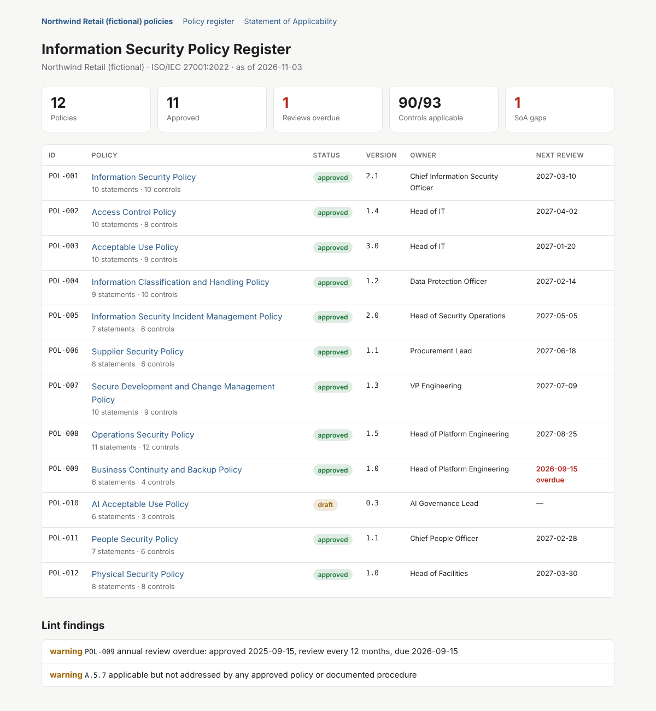

# ISO 27001 Policy as Code

A complete **ISO/IEC 27001:2022 information security policy set**, written in Markdown and managed like software, plus **policykit**, a small Python tool that lints the policies, generates the **Statement of Applicability** across all 93 Annex A controls, and publishes a policy website.



## The idea

Policies usually live in Word files on a shared drive: versions drift, nobody knows which copy was approved, review dates slip, and the Statement of Applicability is a spreadsheet that disagrees with the policies it claims to summarize.

Here, each policy is a Markdown file with structured front matter:

```yaml
---
id: POL-002
title: Access Control Policy
version: "1.4"
status: approved
owner: Head of IT
approver: Chief Information Security Officer
approved_on: 2026-04-02
review_months: 12
statement_prefix: ACP
iso27001_controls: ["A.5.15", "A.5.16", "A.5.17", "A.5.18", "A.8.2", "A.8.3", "A.8.5", "A.8.18"]
---
```

and every requirement has a stable id that audit evidence can point to:

```markdown
- **ACP-04** Multi-factor authentication shall be required for all remote access,
  all cloud and SaaS consoles, and all privileged accounts.
```

Git then provides what a document-management system is supposed to:

| ISMS need | How it's met |
|---|---|
| Document control (clause 7.5) | Every change is a commit with author, date and diff |
| Management approval | The named approver approves the pull request (`CODEOWNERS`); the merge is the approval record |
| Annual review | `policykit lint` flags policies past `approved_on + review_months` |
| Statement of Applicability (6.1.3 d) | Generated from policy front matter plus `soa.yaml`, so it can't drift from the policies |
| Communication to staff | The policy site rebuilds on every merge and publishes to GitHub Pages |

## The policy set

Twelve policies for a fictional retailer, Northwind, covering 89 of the 90 controls it treats as applicable:

| ID | Policy | Annex A focus |
|---|---|---|
| POL-001 | Information Security Policy | 5.1–5.6, 5.8, 5.31, 5.35, 5.36 |
| POL-002 | Access Control | 5.15–5.18, 8.2, 8.3, 8.5, 8.18 |
| POL-003 | Acceptable Use | 5.10, 5.11, 5.32, 6.7, 7.7, 7.9, 8.1, 8.19, 8.23 |
| POL-004 | Information Classification and Handling | 5.9, 5.12–5.14, 5.33, 5.34, 7.10, 8.10–8.12 |
| POL-005 | Incident Management | 5.24–5.28, 6.8 |
| POL-006 | Supplier Security | 5.19–5.23, 8.30 |
| POL-007 | Secure Development and Change Management | 8.4, 8.25–8.29, 8.31–8.33 |
| POL-008 | Operations Security | 8.6–8.9, 8.15–8.17, 8.20–8.22, 8.24, 8.34 |
| POL-009 | Business Continuity and Backup | 5.29, 5.30, 8.13, 8.14 |
| POL-010 | AI Acceptable Use (draft) | 5.10, 5.14, 5.34 |
| POL-011 | People Security | 6.1–6.6 |
| POL-012 | Physical Security | 7.1–7.6, 7.8, 7.14 |

Three physical controls (A.7.11–7.13) are excluded with justifications, because production runs in AWS. Two findings are left in deliberately so the linter has something to catch: POL-009 is past its annual review, and A.5.7 Threat intelligence is not yet covered by any policy.

Browse the generated [Statement of Applicability](docs/statement-of-applicability.md), or the [CSV version](docs/statement-of-applicability.csv) for import into a GRC tool.

## Quick start

```bash
git clone https://github.com/MattSandus22/ISO-27001-Policy-as-code.git
cd ISO-27001-Policy-as-code
python3 -m venv .venv && source .venv/bin/activate
pip install -e ".[dev]"

policykit lint  --as-of 2026-11-03
policykit build --as-of 2026-11-03 -o site && open site/index.html
policykit soa   --format csv -o soa.csv
```

`--as-of` pins the evaluation date so the sample's findings stay stable. Leave it off for a live policy set.

## What the linter checks

**Errors** (block the build):
- Missing front-matter fields, an invalid status, or a malformed or duplicate policy id
- Approved policy with no approver or approval date, or an approval date in the future
- Unknown Annex A control, or a control id that isn't quoted (YAML reads `5.10` as the number `5.1`, which silently maps the wrong control)
- Duplicate statement ids across policies, or a statement that doesn't use its policy's prefix
- `related` pointing at a policy that doesn't exist
- A control excluded from the SoA without a justification

**Warnings** (fail with `--strict`):
- Annual review overdue
- Owner and approver are the same person
- A required section is missing
- A statement without "shall" or "must", which may not be testable
- An applicable control not addressed by any **approved** policy or documented procedure (drafts don't count)
- A control excluded from the SoA that a policy claims to address

## Working with it

- **New policy:** copy [docs/policy-template.md](docs/policy-template.md) into `policies/`.
- **Change a policy:** open a pull request. The [PR template](.github/pull_request_template.md) covers versioning, and `CODEOWNERS` routes it to the owner for approval.
- **Controls met by procedures rather than policies:** record them in `soa.yaml` with `addressed_by`.
- **Publish:** enable GitHub Pages (Settings → Pages → Source: GitHub Actions). [pages.yml](.github/workflows/pages.yml) then deploys the site on every merge to `main`.

## Layout

```
policies/                 the policy set (source of truth)
soa.yaml                  SoA exclusions and non-policy evidence
policykit.yaml            organization name, required sections, review cycle
src/policykit/
  data/annex_a_2022.yaml  93 Annex A control titles
  model.py                front matter, statements, review dates
  lint.py                 rules
  soa.py                  Statement of Applicability
  site.py                 static policy website
docs/                     template, generated SoA, screenshot
tests/                    pytest suite
```

## Notes

- Policies describe a fictional company and are illustrative, not legal advice. Adapt them to your own risk assessment; ISO 27001 controls are selected based on risk, not copied wholesale.
- Annex A control titles are listed for reference; consult the licensed standard for control text.
- POL-010 connects to the companion [AI Risk Register](https://github.com/MattSandus22/AI-Risk-Register), which uses the same fictional company.

## License

MIT. See [LICENSE](LICENSE).
